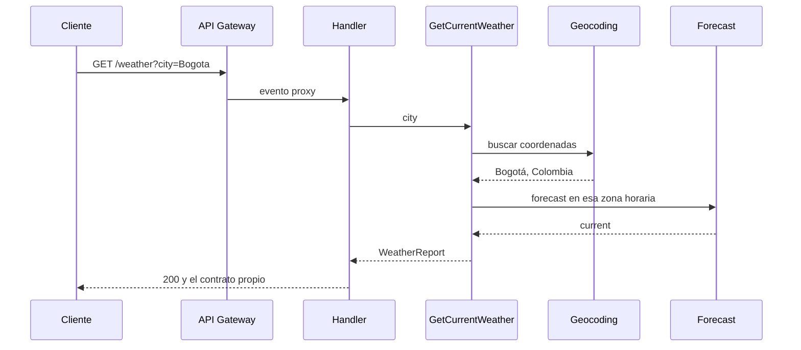

# Weather API

API serverless (Amazon API Gateway + AWS Lambda) que consulta [Open-Meteo](https://open-meteo.com/) y expone el clima actual con un contrato propio, estable y en español.

`GET /weather?city=Bogota` no devuelve el JSON del proveedor. Resuelve la ciudad, pide el tiempo actual y responde siempre el mismo documento o el mismo sobre de error.

## Arquitectura

El handler es un adaptador. No conoce Open-Meteo ni arma el documento de clima.

```text
Cliente
  │  GET /weather?city=
  ▼
API Gateway REST
  ▼
handler.ts                         adaptador Lambda, delgado
  └─ interfaces/http               request id, HTTP, sobre de error
       └─ application              caso de uso: validar → geocoding → forecast → contrato
            └─ domain              tipos del contrato, errores, códigos WMO
       └─ infrastructure           cliente HTTP, parser de Open-Meteo, logs JSON
composition/container.ts           único sitio que une las implementaciones
```

Para cambiar de proveedor se implementan `Geocoder` y `ForecastProvider`. El caso de uso y el contrato HTTP no se tocan.



## Requisitos previos

- Node.js 22 o superior (`node -v`). El runtime de la Lambda es `nodejs22.x`. `.nvmrc` fija 22.
- [AWS SAM CLI](https://docs.aws.amazon.com/serverless-application-model/latest/developerguide/install-sam-cli.html)
- Docker en ejecución. `sam local` levanta la Lambda en un contenedor. No hace falta cuenta de AWS ni credenciales para correr en local.

## Instalar, probar y correr

```bash
npm install
npm test
npm run local
```

`npm run local` compila TypeScript, empaqueta el artefacto con `sam build` y ejecuta `sam local start-api` en el puerto 3000. La primera vez Docker descarga la imagen del runtime. El `sam build` intermedio evita que SAM reutilice un `.aws-sam/` viejo si ya habías construido antes.

Otros comandos:

```bash
npm run lint
npm run typecheck
npm run validate   # lint + typecheck + tests
npm run build      # esbuild empaqueta dist/handler.js
sam build          # copia dist/ al artefacto de SAM
```

La plantilla usa `arm64` (Graviton). En Apple Silicon, `sam local` corre nativo. En una máquina Intel, cambia `Architectures` a `x86_64` en `template.yaml`.

## Ejemplos

Los números del 200 cambian con el tiempo. La forma no. Este es el contrato (el mismo del enunciado):

```bash
curl -sS -D - "http://127.0.0.1:3000/weather?city=Bogota"
```

```http
HTTP/1.1 200 OK
Content-Type: application/json; charset=utf-8
Cache-Control: no-store
X-Request-Id: ...
```

```json
{
  "city": "Bogotá",
  "country": "Colombia",
  "coordinates": { "latitude": 4.60971, "longitude": -74.08175 },
  "timezone": "America/Bogota",
  "current": {
    "temperature": { "value": 14.2, "unit": "°C" },
    "humidity": { "value": 78, "unit": "%" },
    "windSpeed": { "value": 6.5, "unit": "km/h" },
    "condition": "Parcialmente nublado",
    "observedAt": "2026-10-27T09:00"
  }
}
```

`city` sale del geocoding con `language=es`. Por eso `Bogota` puede volver como `Bogotá`. Las unidades salen de `current_units`, no están escritas a fuego. `condition` es el `weather_code` WMO en español. El código 2 es exactamente "Parcialmente nublado".

Falta el parámetro, viene vacío o tiene menos de 2 caracteres:

```bash
curl -sS -D - "http://127.0.0.1:3000/weather"
curl -sS -D - "http://127.0.0.1:3000/weather?city=a"
```

```http
HTTP/1.1 400 Bad Request
```

```json
{
  "error": {
    "code": "INVALID_REQUEST",
    "message": "El parámetro 'city' es obligatorio y debe tener al menos 2 caracteres."
  }
}
```

La ciudad no existe:

```bash
curl -sS -D - "http://127.0.0.1:3000/weather?city=Ciudadinventada"
```

```http
HTTP/1.1 404 Not Found
```

```json
{
  "error": {
    "code": "CITY_NOT_FOUND",
    "message": "No se encontró la ciudad 'Ciudadinventada'"
  }
}
```

Si Open-Meteo no responde, responde con error o tarda más de 5 segundos, la API responde 502 `UPSTREAM_ERROR` con el mensaje "No fue posible obtener el clima en este momento." Un fallo no controlado responde 500 `INTERNAL_ERROR` con "Ocurrió un error interno." Ese cuerpo no lleva stack ni el mensaje interno. El detalle queda en el log, junto con `requestId`.

`X-Request-Id` de la respuesta es el `requestId` de API Gateway y sale en cada línea de log. El id de la invocación de Lambda, cuando es distinto, queda en `lambdaRequestId`. `sam local` repite el id del gateway entre requests; en AWS cada request trae uno nuevo.

## Variables de entorno

| Variable | Ejemplo | Rol |
|---|---|---|
| `GEOCODING_BASE_URL` | `https://geocoding-api.open-meteo.com` | Origen del geocoding. Sin path y sin credenciales. |
| `FORECAST_BASE_URL` | `https://api.open-meteo.com` | Origen del forecast. |
| `UPSTREAM_TIMEOUT_MS` | `5000` | Presupuesto total por petición para Open-Meteo (geocoding + forecast). Entre 100 y 5000. Por defecto 5000. |
| `LOG_LEVEL` | `info` | `debug`, `info`, `warn` o `error`. |

No hay API keys. Open-Meteo no pide registro para este uso. La plantilla SAM declara estos valores como parámetros.

## Logs

Cada evento es una línea JSON. Como mínimo lleva `timestamp`, `level`, `message` y `requestId`. CloudWatch no parte el evento porque el JSON va en una sola línea.

```json
{"timestamp":"2026-10-27T14:00:00.000Z","level":"info","message":"request.completed","requestId":"abc","statusCode":200,"durationMs":840}
```

## Decisiones

- **TypeScript sin framework HTTP.** El enunciado premia TypeScript. NestJS sería más código del que el problema necesita. El handler (`src/handler.ts`) solo crea el entrypoint.
- **SAM y API Gateway REST.** El enunciado muestra `sam local start-api`. El API REST es el que ese comando soporta bien. HTTP API (v2) queda fuera a propósito.
- **Puertos, no un contenedor de inyección.** `Geocoder` y `ForecastProvider` son interfaces. `composition/container.ts` es el único archivo que importa las clases concretas de Open-Meteo. Los tests sustituyen el puerto o `fetch` y no salen a la red.
- **Contrato en el caso de uso.** El nombre de la ciudad y el país son los del geocoding (`language=es`), no el query. Si hay varias coincidencias, Open-Meteo ya las ordena por relevancia y pedimos `count=1`: nos quedamos con la primera. Eso sigue el ejemplo del enunciado. El ranking del proveedor a veces sorprende: `New York` puede resolver a York, Nebraska. Un parámetro `country` lo arreglaría; quedó en las mejoras.
- **Zona horaria del geocoding en el forecast.** `timezone=auto` también funciona. Pasar la zona ya resuelta deja `observedAt` alineado con el campo `timezone` del contrato. La hora se recorta a `YYYY-MM-DDTHH:mm`, que es la precisión del ejemplo.
- **Códigos WMO agrupados, con 0–3 separados.** El ejemplo usa "Parcialmente nublado", que es el código 2, así que despejado, mayormente despejado, parcialmente nublado y nublado no se colapsan en una sola palabra. Niebla, llovizna, lluvia, nieve y tormenta cubren el resto de los grupos principales. Cualquier otro código responde "Condición desconocida" y no tumba la petición.
- **Un presupuesto de 5 s por petición, no por llamada.** El enunciado dice "si Open-Meteo tarda más de 5 segundos". Con un timeout por llamada, geocoding y forecast podrían sumar casi 10 s y aun así responder 200. Cada petición crea un solo `AbortSignal.timeout(UPSTREAM_TIMEOUT_MS)` que comparten las dos llamadas: si entre ambas pasan de 5 s, la respuesta es 502. La Lambda espera 10 s, margen de sobra para un arranque en frío y para devolver el 502. Un timeout, un HTTP no exitoso, un JSON inválido o un cuerpo enorme se traducen a `UPSTREAM_ERROR`. El cuerpo del proveedor no se copia ni al cliente ni al log.
- **Validación en el dominio.** Vacío o menos de 2 caracteres después de `trim`, más de 100 caracteres, o caracteres de control: `INVALID_REQUEST`. No rechazo letras, espacios, apóstrofos ni guiones, porque hay ciudades reales con esos caracteres. `São Paulo` y `St. John's` pasan.
- **Configuración fail-closed.** Una URL con usuario, password, query o path se rechaza en la primera invocación, cuando se carga la configuración. El cliente recibe el 500 genérico. El log dice qué variable falló, no el valor (podría ser un secreto pegado por error). El presupuesto también está acotado a 5000 ms, el umbral del contrato de errores.
- **Un solo archivo para la Lambda.** El typecheck usa módulos ESM. `esbuild` empaqueta `src/handler.ts` en `dist/handler.js` (CommonJS, sin `node_modules`). El runtime Node 22 de Lambda trae desactivada la detección automática ESM/CJS, y un artefacto CommonJS evita ese problema. No hay dependencias de producción.
- **Logs propios, sin Winston.** Una función de veinte líneas escribe el JSON a stdout, que es lo que CloudWatch recoge. El `requestId` de API Gateway gana sobre un header del cliente, para que no se pueda falsificar la correlación.

## Pruebas

Vitest. Open-Meteo está simulado en todos los tests: no hay red. Cubren el mapa de códigos WMO, la transformación al contrato de Bogotá, la validación de `city`, los cuatro errores HTTP y que un 500 no filtra stack ni mensajes internos.

`tests/contract/bogota.test.ts` recorre geocoder, forecast y caso de uso con los JSON de ejemplo y compara el documento completo, incluido el orden de las claves.

## Qué haría con más tiempo

Elegí dos extras que documentan el contrato y cuidan el repo: OpenAPI (`openapi.yaml`) y el workflow de GitHub Actions (lint, typecheck, tests y build en Node 22). El resto lo dejaría para después, en este orden:

1. **Caché de 10 minutos en DynamoDB con TTL**, clave el nombre normalizado de la ciudad, y DynamoDB Local en el arranque. Hoy cada request pega dos veces a Open-Meteo.
2. **Reintentos con jitter** solo para timeout y HTTP 429/502/503, dentro del mismo presupuesto de 5 s de la petición. No reintentaría un 404 ni un 400 del proveedor.
3. **`country` opcional** para desambiguar homónimos (París, Francia frente a París, Texas). Hoy gana el primer resultado de Open-Meteo.
4. **Métricas EMF** de latencia, estado del upstream y código de error, más una alarma sobre `UPSTREAM_ERROR`.
5. **Prueba de contrato nocturna contra Open-Meteo real**, fuera del CI de cada push, para que la suite de PR siga siendo determinista.
6. **Despliegue a una cuenta personal** con `sam deploy`. La plantilla ya publica `WeatherEndpoint`. Después de la evaluación hay que borrar el stack.
7. **`GET /weather/history`** con las últimas 10 consultas, cuando exista la tabla del caché.

## Estructura

```text
src/handler.ts                       entrypoint de Lambda
src/composition/container.ts         wiring
src/application/                    caso de uso y puertos
src/domain/                         contrato, errores, códigos WMO
src/infrastructure/open-meteo/      cliente del proveedor
src/infrastructure/http/get-json.ts timeout y errores de red
src/infrastructure/logging/         logs JSON
src/interfaces/http/                adaptador API Gateway
src/config/env.ts                   variables de entorno
template.yaml                       SAM: Lambda + API Gateway REST
openapi.yaml                        contrato HTTP
tests/                              Vitest, proveedor simulado
```

## Licencia de los datos

Open-Meteo se usa aquí como lo pide la prueba: consulta no comercial, sin API key. El código de este repositorio es el entregable de la prueba técnica.
